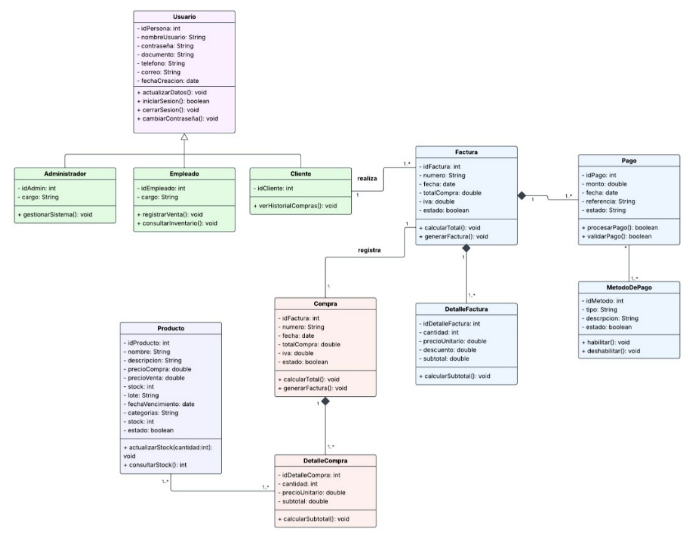

# TodoMarket — Sistema de Gestión

Aplicación de escritorio desarrollada en Java con Swing para gestionar el inventario y los usuarios de un minimercado. Proyecto universitario que demuestra POO, SOLID, MVC, patrones de diseño y CRUD funcional sin base de datos ni frameworks externos.

## Diagrama de clases



---

## Tecnologías

- Java 17+
- Swing (Look & Feel: Nimbus)
- `ArrayList` como almacenamiento en memoria
- `LocalDate` para manejo de fechas

---

## Cómo ejecutar

Desde la carpeta `TodoMarket`:

```bash
mkdir out
javac -encoding UTF-8 -d out -sourcepath src src/minimercado/Main.java
java -cp out minimercado.Main
```

---

## Arquitectura MVC

```
src/minimercado/
├── modelo/        → Entidades del dominio y lógica interna
├── repositorio/   → Contratos e implementaciones de persistencia
├── servicio/      → Reglas de negocio y validaciones
├── controlador/   → Intermediario entre vista y servicio
└── vista/         → Componentes Swing, sin lógica de negocio
```

---

## Módulos implementados (Corte 1)

### Usuarios
CRUD completo de usuarios con tres tipos (herencia de `Usuario`):
- **Administrador**
- **Empleado**
- **Cliente**

Validaciones activas en tiempo real:
- Nombre: solo letras y espacios
- Documento y teléfono: solo números
- Correo: debe ser `@gmail.com` o `@hotmail.com`
- Nombre de usuario único en el sistema

### Productos
CRUD completo del inventario con detección automática de estados:

| Estado | Condición |
|---|---|
| DISPONIBLE | Stock > 5 y no vencido |
| STOCK BAJO | Entre 1 y 5 unidades |
| AGOTADO | Stock = 0 |
| POR VENCER | Vence en los próximos 30 días |
| VENCIDO | Fecha de vencimiento anterior a hoy |

---

## Principios SOLID aplicados

- **SRP** — cada capa tiene una única responsabilidad
- **OCP** — `UIFactory` y los repositorios son extensibles sin modificar lo existente
- **LSP** — `Administrador`, `Empleado` y `Cliente` se usan como `Usuario` sin romper nada
- **ISP** — interfaces pequeñas: `ProductoRepository`, `UsuarioRepository`, `InventarioObserver`
- **DIP** — los servicios dependen de abstracciones, no de implementaciones concretas

---

## Patrones de diseño

| Patrón | Dónde se aplica |
|---|---|
| **Singleton** | `MemoriaProductoRepository` y `MemoriaUsuarioRepository` — una sola instancia del almacén durante toda la ejecución |
| **Observer** | `Inventario` notifica a `ProductoPanel` cada vez que se crea, actualiza o elimina un producto |
| **Adapter** | `ProductoRepository` y `UsuarioRepository` actúan como adaptadores entre la lógica de negocio y el almacenamiento, permitiendo cambiar de `ArrayList` a base de datos sin tocar los servicios |

---

## Notas

Los datos no persisten al cerrar la aplicación. Se cargan registros de demostración automáticamente al iniciar para facilitar las pruebas del CRUD.
